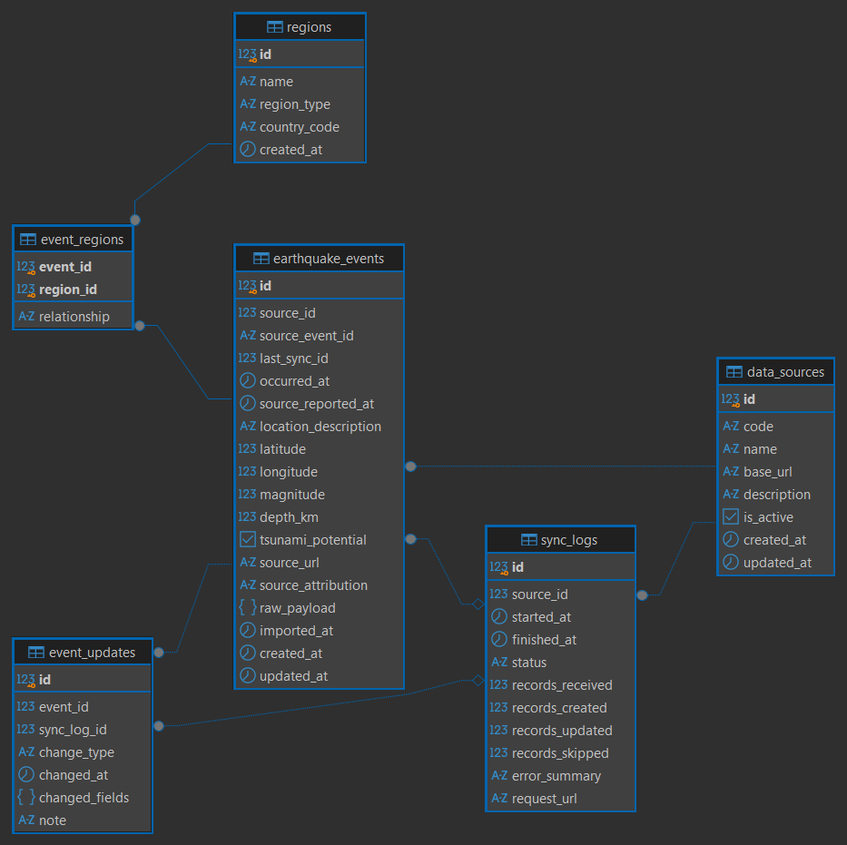

# Heiz database schema (ERD)

Generated in DBeaver from the live Supabase `public` schema. Column details: [schema-columns.md](schema-columns.md).
DDL: [../sql/001_heiz_schema.sql](../sql/001_heiz_schema.sql).

| Table | Purpose | Primary key |
|---|---|---|
| `data_sources` | Information providers (`BMKG`, plus `MANUAL` for API-created records) | `id` |
| `sync_logs` | One row per import attempt (status, counts, URL, sanitized error) | `id` |
| `earthquake_events` | Main resource: normalized earthquake reports | `id` |
| `regions` | Normalized region names (mapped, not yet populated) | `id` |
| `event_regions` | Join table, many-to-many events <-> regions | (`event_id`, `region_id`) |
| `event_updates` | Audit trail: `created`, `updated`, `corrected`, `manual_edit` | `id` |

Foreign keys (7): `sync_logs.source_id`, `earthquake_events.source_id`, `earthquake_events.last_sync_id`,
`event_updates.event_id`, `event_updates.sync_log_id`, `event_regions.event_id`, `event_regions.region_id`.

Not used by the API yet: `regions` / `event_regions` (no reliable region source; regions are not derived from coordinates).
